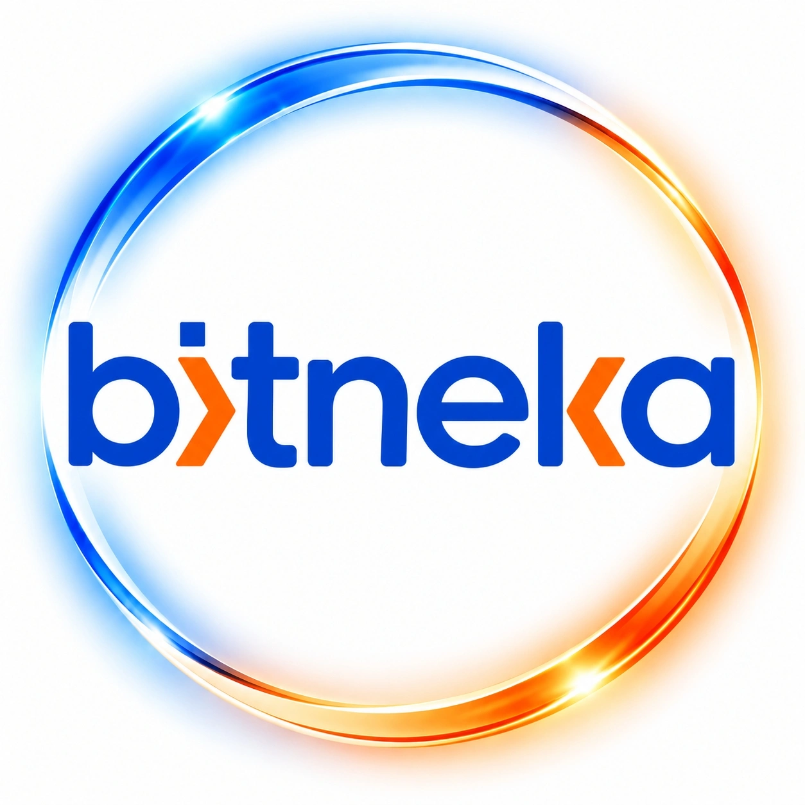

  

<h1 align="center">Bitneka Technologies</h1>

  <strong>Enterprise AI, Automation & Software Engineering</strong> 
  Islamabad, Pakistan · 25+ countries served · 172+ projects delivered

  <a href="https://www.bitneka.com">Website</a> ·
  <a href="https://www.linkedin.com/company/bitneka-technologies/">LinkedIn</a> ·
  <a href="https://www.instagram.com/bitnekaofficial">Instagram</a> ·
  <a href="https://www.facebook.com/bitnekaofficial">Facebook</a> ·
  <a href="https://dev.to/sufyanabbasi">Blog</a>

---

### What we do

- Custom Software Development
- Generative AI & LLM Solutions
- AI Agent Development
- Web Development
- Mobile App Development (React Native)
- UI/UX Design
- Data & Analytics
- Shopify Development
- Microsoft Dynamics 365 ERP/CRM
- Cybersecurity
- DevOps
- IT Staff Augmentation
- Game Development

### Company

- Website: https://www.bitneka.com
- Email: info@bitneka.com
- Phone: +92 333 020 0750
- Location: Islamabad, Pakistan
- Team: 50+ remote professionals
- Founded: 2022

### Connect

  &nbsp;&nbsp;
  &nbsp;&nbsp;
  &nbsp;&nbsp;
  

